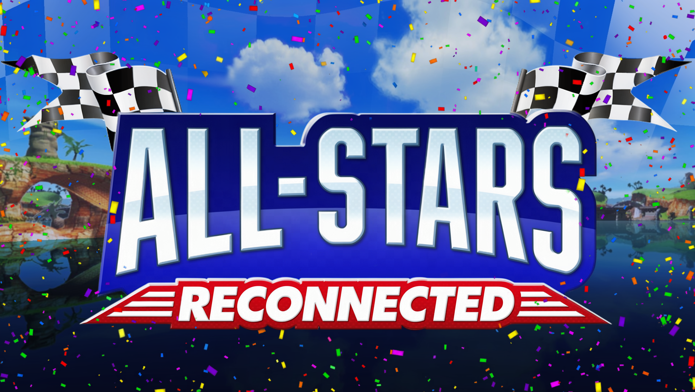

# All-Stars Reconnected

Online races with your friends in **Sonic & SEGA All-Stars Racing** (PC, Steam), through the game's own Multiplayer menus:
Play with Friends, Play with Everyone, Steam "Join Game" and invites. Up to 8 players per lobby, as on the consoles.

This repository holds the mod's **source code, tools and tests**. To play, download the release from the mod's
[GameBanana page](https://gamebanana.com/mods/731708) and follow its README (`package/README.txt` here is the same text). You also need the
[ChaoGarage mod loader](https://github.com/Demaunix/ChaoGarage/releases/latest).

## What's inside

| Folder | What |
|---|---|
| `src/` | The mod's runtime DLL (`SteamMultiplayer.dll`): Steam lobbies, the race bridge, items, AI, voice chat, menus' natives |
| `tests/` | Offline tests (`tests/run_offline.ps1`) |
| `tools/` | Build, packaging and data tools (menus, scenes, archives) |
| `notes/`, `re/*/FINDINGS.md` | Design notes and research write-ups about how the game works |
| `package/` | The release README, changelog and default `config.ini` |

## Building

This repository is the mod's source for reading and reference. **It can't build the mod by itself:** the build also needs
files that can't be shared here, because they are (or are made from) the game's own data:

- script modules from the game and from the mods it works with, kept in `menus/base/` and pinned by SHA-256 in
  `tools/build_menus.py` (the runtime DLL embeds the menus built from them);
- scene and archive files from the game and those mods (`tools/package.py` and the scene tools);
- the [Steamworks SDK](https://partner.steamgames.com/downloads/list) 1.65 in `third_party/steamworks/` (Valve's; only
  `steam_api.dll` is redistributable, and only in releases).

Without them, `build.ps1` stops with a message naming the first missing file. The author builds with Windows, Visual Studio
Build Tools 2022 (x86) and Python 3.12; `tests/run_offline.ps1` runs the offline tests (several read the author's game files).

## No game files here

This repository never contains SEGA / Sumo Digital game data, extracted scripts, executables or Valve's SDK files. The notes
describe how the game behaves (addresses, structures) without containing its code.

## License

All rights reserved, with permission to use and share: see [LICENSE.md](LICENSE.md). In short: play it, share the unchanged
release with credit; ask first before selling it, uploading changed copies or reusing its code.

## Credits

- Mod: Dema ([Demaunix](https://github.com/Demaunix)). Built with Claude.
- SEGA / Sumo Digital: Sonic & SEGA All-Stars Racing and its characters.
- Steamworks SDK by Valve.
- `src/chaogarage/`: ChaoGarage's mod API headers, under their own [MIT license](src/chaogarage/LICENSE).

This is a fan-made modification and is not affiliated with or endorsed by SEGA, Sumo Digital or Valve.
